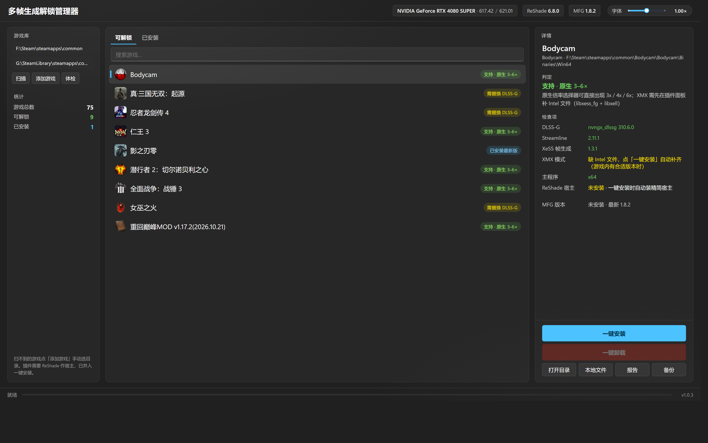

# 多帧生成解锁管理器

**给 RTX 40 系显卡解锁 DLSS 3× / 4× / 6× 多帧生成 —— 一个 13 MB 的单文件工具，双击就能用。**

---

## 它只做一件事

市面上不缺"万能游戏工具箱"，装一堆你永远不会点开的模块。

这个工具反过来：**只做多帧生成解锁的管理**，其他一概不管。所以它很小、很快、很干净。

| | |
|---|---|
| 体积 | 单文件 13 MB，运行时占用约 60 MB |
| 依赖 | 无。不用装 Python、.NET、运行库 |
| 界面 | 一屏放下：库、游戏、详情，没有二级菜单 |
| 上手 | 双击 → 选游戏 → 点「一键安装」 |

## 效果不打折

解锁核心用的是 **Mavismmg 的 MFG Unlock**，目前**唯一在 DLSS-G 路径上做 Blackwell 内核重建**的方案。

这意味着：

- 游戏仍然以为自己跑在 DLSS-G 上，**自己的倍率菜单、Reflex、显示处理全部保留**
- 不像其他方案那样插入一层代理 swap chain，所以 **Alt+Tab、改分辨率、录屏叠加层都不容易出问题**
- 同样的 GPU 负载下**能产出更多帧** —— 它复用的是 DLSS-G 已经付过代价的呈现管线

简单说：**省事，而且更强**。

> 支持 RTX 20 / 30 / 40 系。40 系解锁 3×–6×；20 / 30 系自上游 1.9 起也能跑 DLSS 帧生成（实验性），
> 需要插件在游戏启动前加载，首次进游戏要开两次。

## 三步搞定

1. **双击 exe** —— 首次打开自动扫描全盘 Steam 库（之后走快照，1.8 秒出界面）
2. **选中游戏** —— 列表只显示能解锁的，中文名 + 游戏图标，一眼认得出
3. **点「一键安装」** —— ReShade 宿主、DLSS-G 升级、解锁插件全部自动就位

装完进游戏，帧生成选项里就会出现多出来的倍率。

## 装错了也不怕

每次安装前，被替换的原文件都会进备份目录。点「一键卸载」全部还原，游戏回到原样。

不需要为了试一次而重装整个游戏。

## 还有这些

- **实时在线更新**：每次启动拉取插件与 ReShade 最新版，有新版本列表里标 `!`
- **环境体检**：显卡、驱动、网络、浏览器、磁盘逐项检查，缺什么直接给下载入口
- **一键诊断**：进游戏跑一次点「报告」，桌面生成 txt，写清注入是否成功、插件是否加载、有没有报错
- **XeMFG DLSS-G**（1.10 之前的名字是 XMX）：Intel 生成帧 + NVIDIA 呈现，延迟比传统 XeMFG 低，工具自动判断能不能用（注意：游戏内「超分输出分辨率」设 100%，自动/75% 会让它报错）
- **性能覆盖层**：游戏里 Shift+F10 开关，看输出/游戏帧率、帧时间、1% low、延迟，不开零开销
- **DLSS 5 神经渲染**：1.12 起插件能跑 NR，工具会检查你自备的 `nvngx_dlssnr.dll` 是否就位、面板里开没开、有没有别的 DLSS 5 插件抢位（Ctrl+F8 / Ctrl+F7 游戏内开关与对比）
- **诊断升级**：报告会检查 HAGS、20/30 系早加载、重复插件，并读取插件自己的卡死/崩溃/Streamline 日志
- **右键菜单**：游戏上右键可打开目录、本地安装、生成报告、备份，或把游戏从列表移除
- **完全便携**：数据都在 exe 旁边的 `data\` 目录，不写注册表、不污染 AppData，换机器拷走就行

## 环境要求

| | |
|---|---|
| 系统 | Windows 10 / 11 64 位 |
| 显卡 | NVIDIA RTX 20 系及以上，建议最新驱动 |
| 游戏 | 带 DLSS 帧生成的游戏（工具会自动筛选） |

不满足的话，点左下角「体检」会告诉你缺什么。

## 常见问题

**会不会被反作弊检测？**
不会，它是 ReShade 插件，和画质补丁同类。但**联机游戏请自行判断风险**，竞技类建议不要用。

**为什么我的游戏不在列表里？**
列表只显示能解锁的。扫不到的游戏可以点「添加游戏」手动指定目录。

**装完没效果？**
先看游戏里有没有多出倍率选项；没有就点「报告」，生成的 txt 能定位问题。多数情况是 DLSS-G 版本太旧，重装一次即可。

**Intel 那两个 DLL 是什么？**
只有用 XeMFG 后端 / XeMFG DLSS-G 才需要，安装时会顺手补齐。游戏更新或 Steam 校验会覆盖它们，之后重装一次就好。

## 许可

MIT。随便用、改、分发，保留版权声明即可。

上游 [MFGAdaUnlock-RenoDx](https://github.com/mavismmg/MFGAdaUnlock-RenoDx) 同为 MIT，无冲突。

## 致谢

解锁核心来自 [mavismmg/MFGAdaUnlock-RenoDx](https://github.com/mavismmg/MFGAdaUnlock-RenoDx)，
宿主注入用 [ReShade](https://reshade.me)。

本工具只是把安装流程做简单了，真正的技术工作是作者做的。

---

v1.0.8 · 技术细节见 [docs/TECHNICAL.md](docs/TECHNICAL.md)
